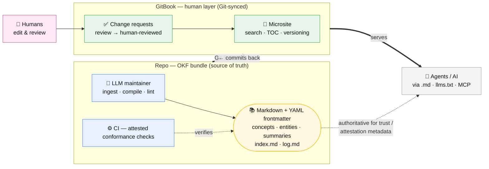

# Presentation layer

An [OKF bundle](open-knowledge-format.md) is deliberately just Markdown + YAML in
git — authoritative and machine-readable, but not, by itself, a pleasant human
surface. A **presentation layer** renders that bundle for people (search, navigation,
versioning, editing/review) *without becoming the source of truth*. It's the human
half of "[one architecture can serve humans and Agents alike](../summaries/one-data-one-meaning.md)."

## At a glance

```mermaid
flowchart LR
    KB(["📚 OKF bundle — source of truth<br/>Markdown + YAML<br/>LLM-maintained · CI-attested"])

    subgraph PL["Presentation layer — render, don't own"]
        direction TB
        OB["💎 Obsidian<br/>local editor / viewer"]
        AS["🚀 Astro<br/>self-hosted static site<br/>(1EdTech microsites)"]
        GB["📘 GitBook<br/>hosted SaaS · edit + review"]
        SP["🏢 SharePoint<br/>enterprise / M365 · Copilot"]
        OT["➕ …others<br/>any Markdown renderer"]
    end

    HUM["👥 Humans"]
    AG["🤝 Agents / AI"]

    KB == "render" ==> PL
    PL --> HUM
    PL == ".md · llms.txt · MCP" ==> AG

    classDef bundle fill:#fef7e0,stroke:#fbbc04,color:#111;
    classDef pl fill:#e6f4ea,stroke:#34a853,color:#111;
    classDef other fill:#eef1f4,stroke:#9aa0a6,color:#555;
    classDef human fill:#fde8f3,stroke:#c2508f,color:#111;
    classDef agent fill:#f1f3f4,stroke:#9aa0a6,color:#111;
    class KB bundle; class OB,AS,GB,SP pl; class OT other; class HUM human; class AG agent;
```

One bundle, a swappable presentation layer, one audience of humans *and* agents. The
options trade control for convenience — local → self-hosted → SaaS →
enterprise/M365; the GitBook case is drawn out in detail below.

## The rule: render, don't own
The compiled bundle stays authoritative — the [LLM maintainer](three-layer-architecture.md)
compiles and lints it, CI attests it. The presentation layer **reads** it (and, if it
also allows editing, commits back through git). It should never hold the
[trust/attestation metadata](provenance-and-trust.md) as its private copy, because
those fields may not round-trip.

## Concrete options
These are examples, not an exhaustive list — anything that can render Markdown + YAML
(a static-site generator, a wiki engine, a docs platform) can serve as the layer.

- **[Obsidian](../entities/obsidian.md)** — a *local* editor/viewer over the vault;
  zero hosting, great for the maintainer, not a public site.
- **[Astro](../entities/astro.md)** — a *self-built, self-hosted* static site;
  schema-validated content collections map onto an [OKF profile](okf-profile.md).
  1EdTech's standards [microsites](../entities/1edtech-ai-enablers.md) are built on it.
- **[GitBook](../entities/gitbook.md)** — a *hosted SaaS* with a WYSIWYG editor,
  **bidirectional Git Sync**, change-request review, and built-in agent endpoints
  (MCP, `llms.txt`, `.md` export).
- **[SharePoint](../entities/sharepoint.md)** — the *enterprise/M365* option: content
  types ≈ frontmatter, approval workflows ≈ the verified tier, and M365 Copilot as
  the query surface — all inside an enterprise governance boundary. Not git/Markdown-
  native, so it needs Graph/Power Automate glue rather than built-in sync.

They sit on one spectrum — local → self-hosted → SaaS → enterprise suite — trading
control for convenience, all rendering the same bundle.

## GitBook, in detail

Humans edit and review in GitBook (change requests → `human-reviewed`); GitBook and
the repo stay in two-way Git Sync; the repo is LLM-maintained and CI-attested; agents
are served via `.md`/`llms.txt`/MCP, with the bundle authoritative for the trust and
attestation metadata GitBook may not carry.

## Why it improves the AI answers too
A presentation layer's own AI search is RAG over whatever it's given. Feed it a
**compiled, attested** bundle rather than sprawling docs and the answers get better
for the same reason the pattern exists — the synthesis already happened
([Gen AI over unstructured docs is not enough](hallucination-baking-risk.md)).

## Sources
- [GitBook — product documentation](../sources/source-gitbook-docs.md)
- [1EdTech (Aracil) — standards adoption](../sources/source-aracil-standards-adoption.md)
- [Molenaar & Nörenberg — One Data, One Meaning](../sources/source-molenaar-one-data-one-meaning.md)

## Related
- [Open Knowledge Format](open-knowledge-format.md) · [Three-layer architecture](three-layer-architecture.md) · [OKF profile](okf-profile.md)
