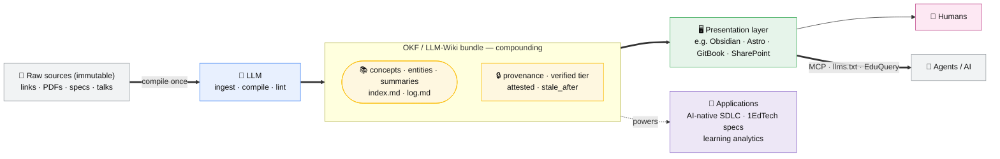

# The LLM-wiki concept — an overview

The front door to this wiki. In one sentence: **have an AI compile scattered
sources once into a persistent, structured, cross-linked knowledge base, and keep
it updated — instead of re-reading raw documents on every question.**

## At a glance

## Why — compile, don't re-retrieve
Traditional RAG re-reads raw documents and rediscovers the same connections on every
query. The LLM-wiki pattern pays that cost **once**, at ingestion, and banks the
result as a durable page — so knowledge **compounds** instead of being rediscovered.
The analogy: raw sources are *source code*; the wiki is the *compiled binary*. See
[LLM Wiki vs traditional RAG](llm-wiki-vs-rag.md) and
[Knowledge as compilation](../concepts/knowledge-compilation-analogy.md).

## The three layers
1. **Raw sources** — immutable; read, never rewritten.
2. **The wiki** — LLM-generated `concepts/`, `entities/`, `summaries/` + `index.md` / `log.md`.
3. **The schema** — [`CLAUDE.md`](../CLAUDE.md): conventions + workflows.

See [Three-layer architecture](../concepts/three-layer-architecture.md).

## The three operations
- **Ingest** — read a source → summarize → touch ~10–15 pages.
- **Query** — read the synthesized wiki, not the raw docs; file good answers back.
- **Lint** — audit for contradictions, orphans, stale claims, broken links.

See [The three operations](../concepts/three-operations.md).

## Making it trustworthy
The pattern's headline risk is that a summary error gets
[baked in as a "fact"](../concepts/hallucination-baking-risk.md) and propagates. The
[Open Knowledge Format](../concepts/open-knowledge-format.md) (OKF) answers this with
machine-readable [provenance and trust](../concepts/provenance-and-trust.md) —
`generated`/`verified` tiers, `stale_after`, and
[Attested Computation](../concepts/attested-computation.md) for computed facts. A
community can tighten OKF into an [OKF profile](../concepts/okf-profile.md).

## Serving it to humans and agents
One bundle, a swappable [presentation layer](../concepts/presentation-layer.md)
(e.g. Obsidian / Astro / GitBook / SharePoint) for people, and agent endpoints
([MCP](../concepts/model-context-protocol.md), `llms.txt`, EduQuery) for machines —
"one architecture can serve humans and Agents alike."

## Where it applies
- **Software** — a compounding memory beside the [AI-native SDLC](llm-wiki-applied-to-sdlc.md).
- **Standards & data** — [OKF bundles of 1EdTech specs](okf-for-1edtech-specs.md) for
  unified semantics and conformance; the [context dictionary](../concepts/context-dictionary.md)
  that turns an interoperable "Completed" event into a teaching decision
  ([One Data, One Meaning](one-data-one-meaning.md)).

## Set it up yourself
Two components enable any LLM-wiki (per [One Data, One Meaning](one-data-one-meaning.md)):
a **Markdown editor** and an **agent harness + LLM**.

1. **Tools** — [Obsidian](../entities/obsidian.md) (edit/view, with a graph view) +
   an agent such as Claude Code with a capable model.
2. **Bootstrap the schema** — make a folder, hand the agent Karpathy's
   [idea file](../sources/source-karpathy-llm-wiki-gist.md), and ask it to write a
   [`CLAUDE.md`](../CLAUDE.md) schema for *your* topic — it should first ask what the
   wiki is about and what sources you'll feed it. (That is exactly how this wiki began.)
3. **Ingest** — give the agent a source (a link or a file); it writes a source note,
   updates the related [concept/entity pages](../concepts/three-operations.md),
   cross-links them, and appends to `log.md`.
4. **Query** — ask questions against the wiki, and file good answers back as new pages.
5. **Lint** — periodically ask it to check for contradictions, orphans, stale claims,
   and broken links.
6. **Harden (optional)** — put it in **git** (the source of truth), adopt
   [OKF](../concepts/open-knowledge-format.md) frontmatter + [trust tiers](../concepts/provenance-and-trust.md),
   run conformance/[attestation](../concepts/attested-computation.md) checks in CI, and
   publish through a [presentation layer](../concepts/presentation-layer.md)
   (e.g. Obsidian / Astro / GitBook / SharePoint).

Copy this repo's [`CLAUDE.md`](../CLAUDE.md) as a starting schema.

## Provider independence — and local LLMs
The bundle is just **Markdown + YAML in git** — no proprietary runtime, SDK, or
account ([OKF is a "format, not a platform"](../concepts/open-knowledge-format.md);
"if you can `cat` a file, you can read it"). That makes the whole pattern
vendor-neutral on three axes:

- **The artifact** — any LLM, agent, editor, or site generator can read and write the
  bundle. Nothing about it is tied to one provider; it outlives whichever tool made it.
- **The agent harness** — Claude Code is one option; Codex-style agents (via an
  `AGENTS.md`), Open Code, Aider, and others work too. The [schema](../CLAUDE.md) is a
  plain-text convention, not an API. Joshi's walkthrough and the
  [One Data, One Meaning](one-data-one-meaning.md) talk both note the pattern runs on
  "any agent" and "most common models."
- **The model** — you can run ingest / compile / lint with **open-weight models**
  (Llama, Qwen, Mistral, DeepSeek) locally via Ollama, LM Studio, or llama.cpp. The
  format and workflow are identical; only *synthesis quality* scales with model
  capability — compiling and cross-linking many pages in one pass is the demanding
  step, so a stronger model helps there, while a smaller/local one can still handle
  queries.

Why it matters:
- **Privacy & data residency** — run a local model over sensitive learner or
  enterprise data so nothing leaves the premises (the governance concern behind
  [One Data, One Meaning](one-data-one-meaning.md) and [SharePoint](../entities/sharepoint.md)).
- **Longevity & no lock-in** — the knowledge survives any single vendor; the bundle is
  still readable in a plain text editor years from now.
- **Mix and match** — a capable model for ingestion, a cheap or local one for queries;
  [provenance](../concepts/provenance-and-trust.md) even records *which* model/tool
  generated each page (the `generated.by` actor), so you can track or gate by model.

## Lineage
Vannevar Bush's 1945 [Memex](../concepts/memex.md) (associative trails, abandoned over
bookkeeping) → Karpathy's [LLM Wiki](../sources/source-karpathy-llm-wiki-gist.md)
(the LLM does the bookkeeping) → Google's [OKF](../entities/google-cloud-knowledge-catalog.md)
(an interoperable format) → applied to EdTech by [1EdTech](../entities/1edtech.md) and
in [this talk](one-data-one-meaning.md).

## This wiki is its own example
Everything above is maintained *as* an LLM-wiki/OKF bundle — the method describing
itself. Start exploring from [index.md](../index.md); the
[change log](../log.md) shows how it compounded.

## Sources
- [Karpathy — LLM Wiki gist](../sources/source-karpathy-llm-wiki-gist.md)
- [Joshi — LLM Wiki walkthrough](../sources/source-joshi-medium-llm-wiki.md)
- [Google Cloud — OKF blog](../sources/source-google-okf-blog.md)
- [OKF Specification v0.2](../sources/source-okf-spec.md)
